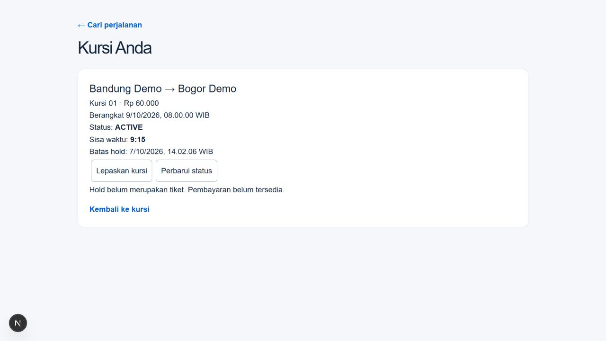
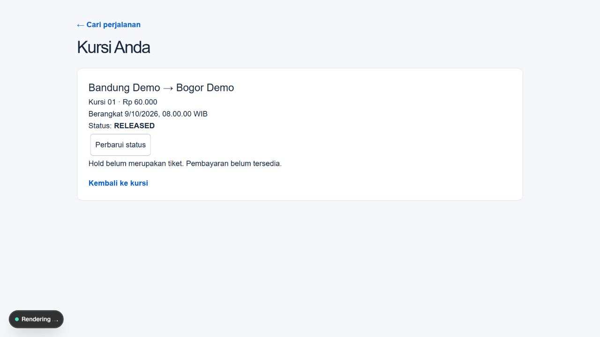

# Availability and seat hold — local setup

Approved spec and plan: [design](../superpowers/specs/2026-10-07-availability-hold-design.md), [plan](../superpowers/plans/2026-10-07-availability-hold.md). Implemented 7 October 2026.

## Use

Run `npm run dev`, then open `/trips`. Choose snapshot source stops and the origin's departure date in WIB. Open the result, choose an interval and one seat, then hold it while logged in. `/holds/[id]` reopens the owner's hold and supports release. Internal accounts can also use this passenger flow. The existing verified Crew A session was used for browser verification.

Database migrations `0004_availability_holds.sql` and `0005_hold_terminal_timestamps.sql` add holds and transition audit, composite tenant/trip references, request-key uniqueness, state/time checks, RLS and revoked browser grants. Domain code lives in `modules/inventory`; browser mutations use verified server identity.

One hold lasts ten minutes. Adjacent intervals can reuse a seat; overlapping active, unexpired holds cannot. Create/release/cleanup share company → trip → ordered full-range inventory locking. Time is rechecked after locks. Same-owner/request-key retries return the original hold and deadline. Expired ACTIVE records stop blocking immediately, even before maintenance persists EXPIRED.

## Maintenance

Use `npm run db:expire-holds` with the existing verified development migration URL and trusted CA environment. It examines at most 100 candidates, commits each transition separately, prints counts only, and provides no public endpoint. Initial run: `{examined:0, expired:0, failed:0}`. Do not put secrets in committed files.

## Evidence

- Unit suite: 148 tests / 28 files passed; typecheck, lint and production build passed.
- Final full development database suite: 41 tests / 9 files passed. Terminal timestamp/range/expiry constraints were also checked directly after migration 0005.
- 50 actual concurrent attempts from distinct fixture profiles: exactly one success and 49 semantic conflicts, with an ten-connection raw client pool and 120-second test deadline and 15-second connection handshake timeout. Inventory lock/statement timeouts remain 5/15 seconds.
- Raw and application Drizzle clients, adjacent ranges, same-key same/different payload races, owner isolation, audit rollback/object JSON, same-company FK, suspension/cutoff waits, release/expiry, cleanup partial failure and missing anchors covered.
- Additional passing checks: deterministic release/cleanup barriers use `pg_blocking_pids`; default cleanup candidate selection limited to 100; draft and unknown trip rejection.
- Browser: search 9 October WIB, Bandung→Bogor Rp60,000, keyboard selection, create hold, reload same hold/deadline, release to RELEASED, availability restored; Cianjur→Bogor Rp35,000 and 390px viewport checked without horizontal page overflow.

One final read-only GPT-6 Luna medium reviewer found no critical/important correctness issues. Browser evidence used an existing session: a fresh OTP login/return, second-account browser conflict, and real ten-minute browser expiry were not performed. Ownership/concurrency/logical expiry are covered by database tests. Payment initiation, booking conversion, confirmed seat assignments, tickets and guest flows remain the next slice; no payment button is supplied. No push or deployment.

## Final fixes

Regression tests reproduced and then verified fixes for microsecond expiry/cutoff comparison, safe unavailable errors during initial idempotency lookup, one-shot countdown refresh, and nullable terminal CHECK semantics. Migration 0005 preserves migration 0004. One full run hit a pooler connection handshake timeout; the final inventory test pool uses max10/connect_timeout15 and the complete41-test rerun passed. Production lock and statement limits remain5/15seconds.

## Local integration

Branch `codex/availability-hold` fast-forward merged into main at `2f88ad3` on 7 October 2026. Integrated checkout: 148 unit tests and typecheck passed. The pre-existing `next-env.d.ts` was preserved byte-for-byte (SHA256 B8B3A344484B959AF5E4E3FC1A1609DAC3CB9ECE0CDEB6C145BE29BC4C491000). Worktree preview stopped; main preview `/trips` was verified at http://localhost:3000/trips. Additional measured cutoff-anchor barrier passed. No push or deployment.
