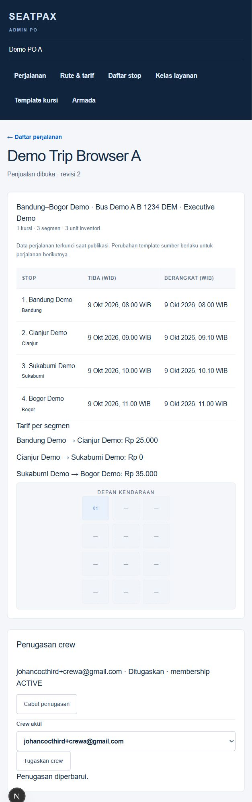
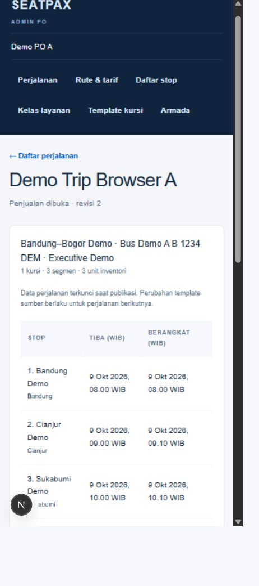

# Seatpax Trip Engine setup and verification

Date: 7 October 2026. Worktree: `day3-email-otp/SeatPax`. This records the implemented preparation slice and the evidence available at handoff. No production deployment or push is included.

## Implemented

- Revisioned Admin PO trip drafts with source choices, preview/blockers, and stale revision protection.
- Atomic first publication into independent route identity, stop schedule, adjacent fare, full layout, and seat snapshots. Publication also creates one inventory anchor per snapshotted seat × adjacent segment. Repeating publication returns the existing publication.
- WIB input/display with instant storage; publish-time source and schedule validation.
- Same-company crew assignment/revocation, audit transitions, and crew reads limited to assigned published trip snapshots after fresh membership/assignment checks.
- Thin Next.js adapters and admin/crew pages backed by `modules/trip` domain services. Schema is in Drizzle migration `0003_trip_engine.sql`.

Availability/search, holds, booking, payment, passenger information, manifest, QR/boarding and operational trip lifecycle are not implemented. Inventory anchors are lockable units only; they do not indicate that a seat is available or sold.

## Automated evidence

- Full unit suite: **137 tests across 24 files passed**.
- Full database suite before the Drizzle serialization fix: **25 tests across 6 files passed**.
- A regression test through the application Drizzle adapter first reproduced the JSON serialization failure (RED), then passed after the fix (GREEN, **1 test passed**). The first full rerun caught raw-client double serialization; after the text-typed fix, the full database suite passed: **26 tests across 6 files**.
- Typecheck: passed.
- Lint: passed.
- Final GPT-6 Luna review (medium): no findings.

The application path exposed a Drizzle JSON serialization error that raw PostgreSQL integration tests did not reproduce. JSONB writes for publication snapshots/layout, source identity and crew audit now explicitly serialize JSON with `JSON.stringify`, bind it as PostgreSQL text (OID 25), then cast with `::jsonb`. This avoids both the Drizzle transparent serializer error and raw-client double serialization. The regression test covers the application Drizzle path. The production build passed after the fix. The full DB suite post-fix rerun passed. The focused Luna follow-up review of the fix found no issues.

## Browser evidence and limits

Admin A saved and reopened a demo draft. Initially the first-stop departure offset was missing, so preview showed the specific blocker and disabled publication. After setting route departure/arrival offsets to `0`, `60/70`, `120/130`, and `180` minutes, preview showed the four expected WIB stop times.

Admin A published **Demo Trip Browser A**, trip ID `3663d259-37e8-4825-9da0-172a9bf734eb`. The published trip is `OPEN_FOR_SALE`, revision 2, with one seat, three adjacent segments, and three inventory anchors. Snapshot fares were IDR 25,000 / 0 / 35,000. Crew assignment and reactivation for crewA succeeded; revocation was triggered with the keyboard. Admin A's attempt to open the PO B trip URL returned 404. A narrow 390×844 layout was inspected.

The service class override was verified in the database path only; the browser fixture exposed just one available class, so UI override behavior remains unverified. Crew A logged in, saw only the assigned demo trip in its list, and opened the published snapshot with the same stop times, fares and layout. The screenshots below show the published desktop and narrow layouts.

## Local integration

Branch codex/trip-engine was fast-forward merged into main on 7 October 2026. Integrated-checkout unit tests (137) and typecheck passed. The pre-existing next-env.d.ts change was preserved. The worktree server was stopped; the main preview uses http://localhost:3000. No push or deployment was performed.

See the [approved Trip Engine design](../superpowers/specs/2026-10-07-trip-engine-design.md), [implementation plan](../superpowers/plans/2026-10-07-trip-engine.md), and [decision D2026-10-07-04](../seatpax/19_DECISION_LEDGER.md).
